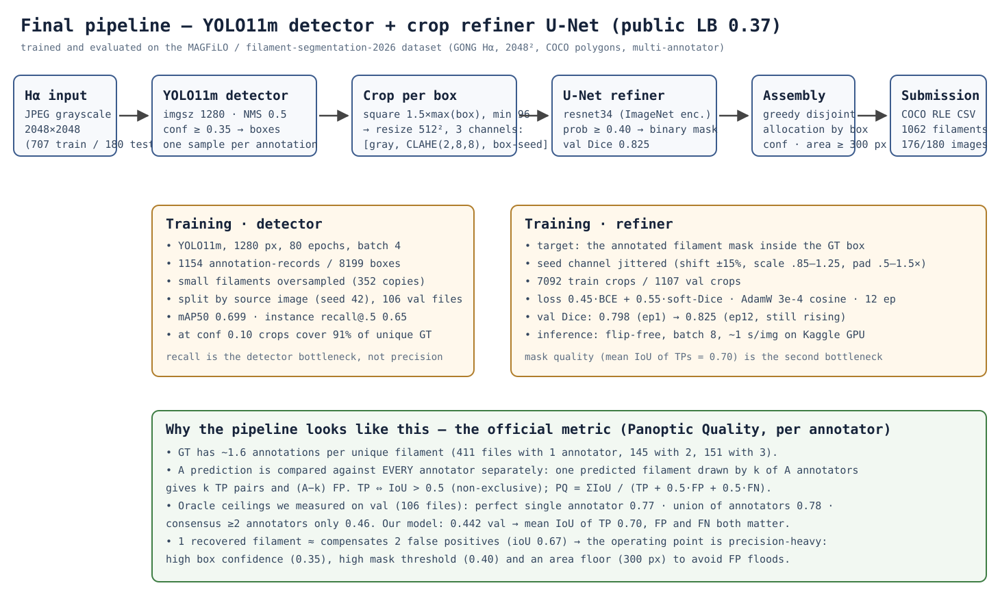
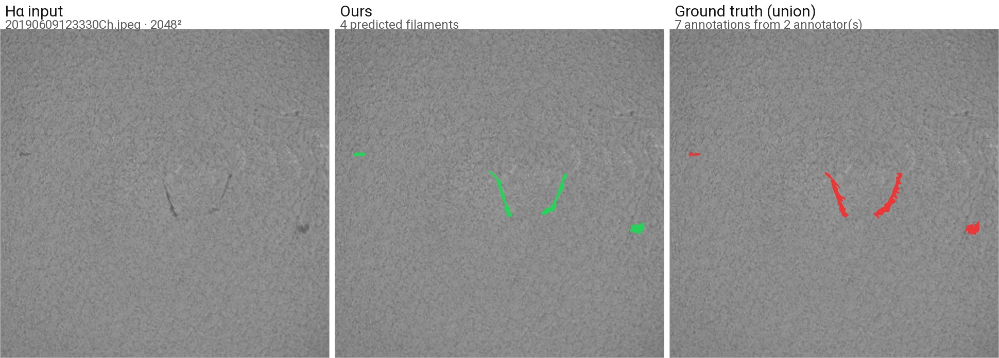
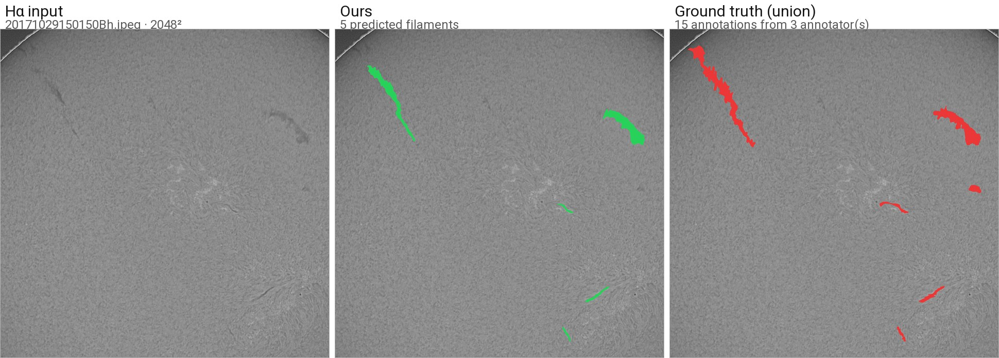
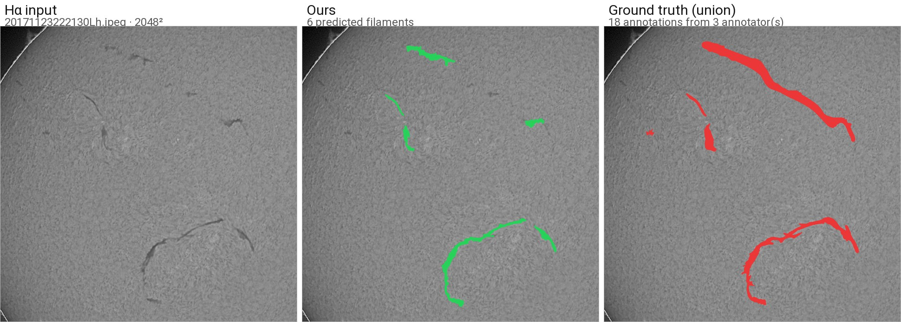
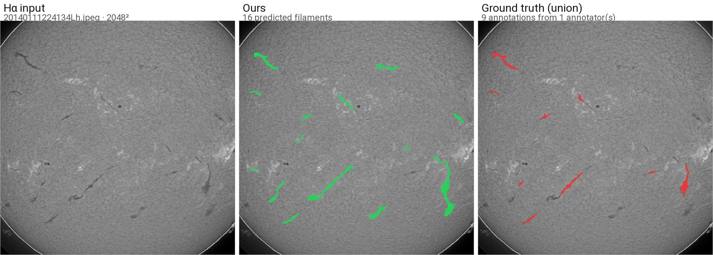
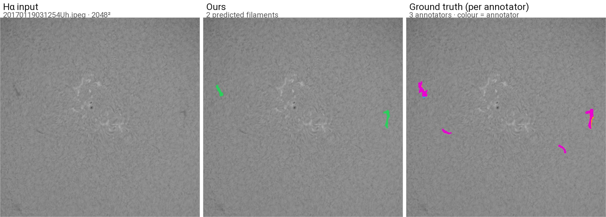

# Solar Filament Segmentation 2026 — Final Report

**Team:** juanmirod · **Competition:** [filament-segmentation-2026](https://www.kaggle.com/competitions/filament-segmentation-2026) · **Deadline:** 2026-11-15
**Best public LB:** **0.37** (submission `56888475`, 2026-10-06) · **Baseline:** 0.20 (U-Net, 19-sep)
**Data:** MAGFiLO 1.0 (MLEcoFi 2024) — GONG Hα full-disk images, 2048×2048 px, COCO polygon annotations, 707 train / 180 test images, up to 3 independent annotators per image.

---

## 1. Executive summary

We built an **instance-segmentation cascade**:

> **YOLO11m detector** (1280 px, conf ≥ 0.35) → one square crop per box → **U-Net resnet34 refiner** with a box-seed channel (512 px, prob ≥ 0.40) → **greedy disjoint allocation** by box confidence → COCO-RLE submission.

This is the last and best of three generations of pipelines we tried:

| Generation | Approach | Public LB |
|---|---|---|
| 1 | Semantic U-Net / resnet34 (consensus target) + TTA + threshold/area tuning + 4-model ensemble | 0.34 |
| 2 | 5-model semantic ensemble (`r7`+`m7`+`m8` checkpoints), no-TTA 768/640, fine calibration | 0.36 |
| 3 | **Instance cascade: YOLO11m → crop-refiner512** (this report) | **0.37** |

What moved the needle, in order of impact:

1. **Understanding the metric** (PQ evaluated *per annotator*, not per image) — this reframed the whole problem and set the target (consensus) and the operating point (precision-heavy).
2. **Instance structure** (detector + refiner + disjoint allocation) instead of semantic masks + connected components.
3. **Operating point tuning** (confidence 0.35, mask threshold 0.40, area ≥ 300 px) — cheap, worth ≈ +0.03 val over naive settings.
4. **Detector quality on small filaments** (YOLO11m + small-object oversampling) — recall @IoU 0.5 went from 53% to 59–76%, worth +0.008 val.

What did *not* move the needle (each was measured, not guessed): longer/union-targeted training, more ensemble members, morphological post-processing, shape filters, mask-confidence ranking, semantic-agreement filtering, and more test-time augmentation variants. The remaining error is dominated by **missed small filaments (FN ≈ 470 of 1107 GT annotations on val)** and **mask quality (mean IoU of hits ≈ 0.70 vs ≈ 0.89 for an oracle)**.

---

## 2. The problem is the metric

The official rubric is explicit:

- **70% quantitative**: Dice, **Panoptic Quality (PQ)** on the leaderboard, plus distributions of Dice/IoU and of one-to-many / many-to-one relations between GT and predictions.
- **30% qualitative**: pipeline description, apparent morphology of the segmentations, code quality — with an **open-access requirement on the source code**.

PQ here is computed *per annotator*: the GT contains 1154 annotator-images over 707 physical JPEGs (411 files with 1 annotator, 145 with 2, 151 with 3). A single predicted filament is compared separately against every annotator's annotation of that image:

- TP ⇔ IoU > 0.5 (non-exclusive: one prediction can be TP for several annotators),
- a filament drawn by *k* of *A* annotators gives **k TP pairs and (A−k) FP**,
- PQ = ΣIoU / (TP + 0.5·FP + 0.5·FN).

We replicated the official scorer locally (`08_scorer_oficial.py`, verified against an independent implementation and against known leaderboard orderings), then measured the theoretical ceilings on the 106-file validation split:

| Oracle construction | PQ (val) |
|---|---|
| Union of all annotators + connected components | **0.7754** |
| A single annotator, perfectly predicted | 0.7721 |
| One instance per annotator cluster | 0.7032 |
| Consensus ≥ 2 annotators (union) | 0.4575 |

Two consequences drove every decision that followed:

1. **The consensus target (positive = ≥2 annotators) has a ceiling of ≈0.46, and our model reaches 0.44 val — we are at 96% of that ceiling.** To go beyond ≈0.46 the model must predict the *union* (anything any annotator drew) at high contour quality.
2. **The metric's economics**: recovering one missed filament adds ≈ +0.46/D, while one junk prediction costs ≈ −0.21/D (D ≈ TP + 0.5·FP + 0.5·FN). So **one recovered filament is worth about two false positives** — but only if its contour is right. At mean IoU 0.67, predicting single-annotator filaments is roughly neutral; at IoU ≈ 0.9 it becomes clearly profitable.

That is why the final pipeline is recall-oriented at the detector level but precision-heavy at the output level.

---

## 3. Final architecture

### 3.1 Detector — YOLO11m

- **Input**: grayscale Hα JPEG, resized to 1280 px.
- **Training data**: one sample per annotation record (the dataset has 1154 annotation-records / 8199 boxes); **small filaments oversampled** (352 duplicated small boxes) to fight the size imbalance.
- **Split**: by source image, seed 42 → 106 validation files (identical across all experiments in the project).
- **Training**: 80 epochs, batch 4, Ultralytics YOLO11m (ImageNet pretrained), ~3 h on a free Kaggle GPU.
- **Validation**: mAP50 **0.699**, mAP50-95 0.413, instance recall @IoU 0.5 = 0.65 at conf 0.28.

The detector is *not* run only at its default operating point. We dump boxes down to conf 0.05 and study the **crop-level ceiling**: the fraction of unique GT filaments whose center falls inside some predicted crop (1.5× the box):

| box confidence | unique-GT recall @IoU 0.5 | crop coverage of unique GT |
|---|---|---|
| 0.35 | 53.5% | 68.6% |
| 0.28 | 58.9% | 75.9% |
| 0.10 | 75.6% | **90.9%** |

So the detector *can* bring almost every filament into a crop — the bottleneck in practice is that the extra low-confidence boxes are mostly junk that the refiner cannot reject. The best operating point that balances the two is conf ≈ 0.30–0.35.

### 3.2 Crop refiner — U-Net resnet34

For every detected box:

1. **Crop**: square crop of side `1.5 × max(box_w, box_h)`, minimum 96 px (clipped to the image).
2. **Resize** to 512×512 and build **3 input channels**: grayscale, CLAHE(2.0, 8×8), and a **box-seed channel** (the detector box filled, padded by 40%).
3. **Refiner**: `smp.Unet(resnet34, ImageNet)` trained on GT-box crops (7092 train / 1107 val crops) with the annotated filament mask as target. The seed channel is **jittered during training** (shift ±15%, scale 0.85–1.25, pad 0.5–1.5×) to imitate detector boxes.
4. **Loss / optimisation**: 0.45·BCE + 0.55·soft-Dice, AdamW 3e-4 cosine, batch 8, 12 epochs (~45 min GPU). Validation Dice went 0.798 (epoch 1) → **0.825 (epoch 12, still rising)** — training longer is a known easy gain.
5. **Inference**: sigmoid ≥ 0.40, resize the mask back to full-image coordinates, drop masks < 300 px.

### 3.3 Assembly and submission

- All masks of an image are sorted by **box confidence** and greedily assigned with a **disjoint allocation** (a lower-ranked mask can only keep pixels not already claimed). This removes almost all fragmentation and over-merging (val: 0 fragmented GT, 0 over-merged predictions).
- Final masks are encoded as COCO RLE (`filament_id = "<stem>_<i>"`), one row per filament.
- Test run: 180 images → 1088 crops → **1062 filaments over 176 images** (median area 1441 px), ~135 s end-to-end on a Kaggle GPU.

### 3.4 Final operating point

| knobs | value | why |
|---|---|---|
| detector conf | **0.35** | optimum of the measured conf×thr grid (higher conf loses recall, lower floods FPs) |
| mask threshold | **0.40** | flat around 0.40–0.50 |
| minimum area (post-allocation) | **300 px** | removes leftover slivers; +0.007 val |
| NMS | 0.5 | default |
| crop | 512, context 1.5, pad 0.40 | inherited from the reference recipe, never beaten |

**Validation (106 files, official replica): PQ 0.4418 · TP 637 · FP 262 · FN 470 · mean IoU of TP 0.696.**
**Public LB: 0.37.**

---

## 4. Results and error analysis

### 4.1 Leaderboard progression

| date | submission | configuration | public LB |
|---|---|---|---|
| 19-sep | 56352290 | U-Net baseline | 0.20 |
| 21-sep | 56441564 | resnet34 semantic, tuned threshold | 0.24 |
| 22-sep | 56468369 | consensus target (B1) | 0.27 |
| 23-sep | 56477049 | 4-model ensemble + TTA | 0.34 |
| 26-sep | 56585590 | 4 long-models, no-TTA 768/640, thr 0.35 / A400 | 0.36 |
| 28-sep | 56648735 | 5-model ensemble | 0.35 |
| 30-sep | 56717552 | **cascade v1** (YOLO11s + refiner) | 0.36 |
| **6-oct** | **56888475** | **cascade v2** (YOLO11m conf 0.35, thr 0.40, A300) | **0.37** |

### 4.2 Where the errors are

- **FN 470** (of 1107 GT annotations): missed filaments are **about 3× smaller** than detected ones (median 2678 px² vs 5419 px² at conf 0.15) and often faint. 2 of 106 validation files receive no box at all even at conf 0.05.
- **FP 262**: junk boxes below the chosen confidence still produce plausible-looking masks — they are *not* separable by mask confidence or by the semantic ensemble (both were measured, see §5).
- **Mask quality**: mean IoU of true positives is 0.696, while an oracle of the union of annotators reaches 0.89. The refiner systematically under-covers thin barbs and filament ends.
- **Annotator noise is a hard floor**: on the val split the mean IoU between paired annotator drawings of the same filament is only ≈0.65 — two humans agree with each other less than our model agrees with them on its TPs.

---

## 5. What we measured and rejected

All numbers on the 106-file validation split (official scorer replica) unless noted.

| idea | result |
|---|---|
| Union target (predict anything any annotator drew) | worse than consensus at the *old* operating point (0.386 vs 0.421); at the current point reduces to +TP/+FP churn: 0.4418 → 0.4375 with the same knobs |
| 5th ensemble member (resnet50), 4th long model | neutral to negative |
| Morphology: opening / closing / erosion / dilation / core | −0.01 to −0.10 |
| Shape filters (elongation, solidity) | ±0.002, not usable |
| Test-time augmentation | helped the semantic generation (TTA 1024/768), neutral-to-harmful for the cascade |
| Threshold / area fine sweep | already at optimum (0.35–0.40 / 300–500) |
| Ranking the disjoint allocation by refiner mask confidence | +0.0003 (noise); ranking by mask confidence *alone* loses up to −0.01 |
| Semantic agreement filter (drop masks where a 4-model ensemble probability is low) | +0.003 with the aggressive threshold only; not worth shipping |
| Area post-filter (empty-sliver removal) | **+0.007 — kept** |

**Lesson:** after the pivot to instances, the remaining levers are about *model quality* (detector recall on small objects, refiner accuracy), not about tuning the assembly.

---

## 6. Qualitative examples

**Example 1 — near-perfect case.** 7 GT annotations from 2 annotators; we output 4 filaments: 6 TP pairs, 0 FP, 1 FN. Notice how a single predicted mask satisfies two annotators at once — this is exactly the behaviour the metric rewards.

**Example 2 — strong multi-annotator case.** 15 annotations from 3 annotators; 11 TP pairs, 0 FP, 4 FN. The model recovers most of the consensus filaments with clean contours.

**Example 3 — the recall failure mode.** 18 annotations from 3 annotators; 12 TP, 1 FP, **6 FN**. The long filament at the top is only partially covered (our mask stops where it gets faint), and the lower arc is under-segmented. Missing faint barbs/ends is the single largest source of lost PQ.

**Example 4 — the noise failure mode.** Single annotator, 9 GT; we output 16 filaments: 5 TP, **11 FP**, 4 FN. Extra crops below the confidence threshold produce filament-like masks on cloud edges and bright plage — they look right to both the refiner and the semantic ensemble.

**Example 5 — why the task is ambiguous (per-annotator GT).** 3 annotators, 7 annotations, 2 of which are drawn by *all three* (overlapping colours). We predict only 2 filaments: the consensus pair is recovered, the singleton annotations are missed. Two annotators see a filament here, one does not — and the metric scores each opinion separately.

---

## 7. Paths to improve

Ordered by expected value per unit of effort. Each item lists the concrete next experiment and the source that justifies it.

### A. Refiner quality (highest expected value, cheapest)

1. **Train the refiner longer** — validation Dice was still rising at the last epoch (+0.027 from ep1 to ep12). 24–30 epochs is ~2 h GPU and should translate directly into IoU of TPs.
2. **Flip TTA at refiner inference** — 4 dihedral flips cost ~4× refiner time (still seconds per image) and typically add +0.005–0.01 Dice. PQ scales with ΣIoU, so this is nearly free.
3. **Higher-resolution crops** (640/768 px) and **multi-scale crops** (512+768 averaged) — thin barbs are structurally lossy at 512.
4. **Stronger encoder**: mit_b3/mit_b5 (SegFormer) or ConvNeXt-T; our earlier semantic models showed mit_b3 ≈ resnet34 ±0.005, but as a *refiner* the transformer encoder's global context may help thin structures ([EdgeAttNet](https://arxiv.org/abs/2509.02964) argues exactly this for barbs).

### B. Detector recall on small objects (the FN bottleneck)

5. **Slice-based inference / training (SAHI)** — [Slicing Aided Hyper Inference, arXiv:2202.06934](https://arxiv.org/abs/2202.06934): run the detector on overlapping tiles (e.g. 512–768 px crops at 1280 resolution) so small filaments are seen at native scale. The measured 91% crop coverage at low confidence suggests most misses are a *scale*, not a *semantics*, problem.
6. **Copy-paste augmentation for small filaments** — [Simple Copy-Paste, arXiv:2012.07177](https://arxiv.org/abs/2012.07177), combined with the existing oversampling.
7. **Model capacity / architecture**: YOLO11x/l, or DETR-family detectors ([DINO, arXiv:2203.03605](https://arxiv.org/abs/2203.03605); RF-DETR-Seg is already used by public notebooks on this competition).
8. **Two-detector union** (YOLO11m + a tiled detector) with score fusion before the refiner — cheap way to convert detector diversity into recall.

### C. Instance segmentation beyond detector+refiner

9. **Mask R-CNN / Mask2Former trained directly on instances** — the public recipe that reached LB 0.70 pre-fix uses Mask R-CNN (1024) + a small U-Net refiner ([Mask R-CNN, arXiv:1703.06870](https://arxiv.org/abs/1703.06870); [Mask2Former, arXiv:2112.01527](https://arxiv.org/abs/2112.01527)). Our detour through YOLO+refiner was motivated by crop-level supervision; the transformer mask decoders predict finer boundaries natively.
10. **SAM / SAM2 as the refiner** — [Segment Anything, arXiv:2304.02643](https://arxiv.org/abs/2304.02643), [SAM 2, arXiv:2408.00714](https://arxiv.org/abs/2408.00714), and especially [HQ-SAM, arXiv:2306.01567](https://arxiv.org/abs/2306.01567) for thin structures: prompt SAM with the detector box (and/or the annotated spine as point prompts) instead of a from-scratch U-Net. SAM was released after the public 0.70-era recipes and is still under-used in this competition.
11. **Semantic-first + instance disambiguation**: the strongest public "no-detector" recipe ([U-Net 0.55+](https://www.kaggle.com/code/lamhuy8904/solar-filament-unet-segmentation-0-55)) segments at native 2048 resolution and splits with a greedy disjoint allocation. Our own numbers show the same: the cascade's precision advantage is real, but a native-resolution semantic model could provide better boundaries to the same allocation.

### D. Better use of the annotations

12. **Spine supervision** — the COCO JSON carries a `spine` polyline per filament (from the [Toward Filament Segmentation](https://arxiv.org/abs/1912.02743) annotation effort). A spine-consistency auxiliary loss (or spine-aware connectivity for instance separation) targets exactly the thin-structure failure mode.
13. **Multi-annotator soft labels** — instead of collapsing annotations to consensus/union, train against the *distribution* (e.g. soft target = fraction of annotators marking each pixel). The metric scores each annotator separately, so an uncertainty-aware prediction can dominate both hard targets. This is the least-explored direction with the highest upside above the 0.46 consensus ceiling.
14. **Pseudo-labelling the test set** with the current cascade (and re-training the refiner) — 180 unlabelled test images, free compute.

### E. Assembly and metric-aware decisions

15. **Per-image threshold selection**: choose (thr, area) per image by maximising the *analytic* expectation of PQ (we have the exact economics: recover a filament +0.46/D, junk −0.21/D). Images differ hugely in filament density.
16. **Merge fragmented filaments before submission** (across nearby crops, using overlap or spine alignment) — the official rubric explicitly penalises one-to-many relations; our disjoint allocation prevents most, but not all, of them.
17. **Score fusion across the two generations** (semantic ensemble and cascade): a mask accepted by both is very likely a TP; disagreement is where per-image arbitration pays.

### F. Efficiency (part of the rubric)

18. Export detector + refiner to **ONNX/TensorRT**, report end-to-end latency/FLOPs: the rubric mentions computational efficiency, and the current pipeline is already fast (~135 s for 180 images).

### G. The qualitative 30%

19. **Publish the code and this documentation** (open-access policy is a scoring condition), keep the modular scripts (`data → train → eval → submit`), and include the per-annotator analysis — it demonstrates understanding of the metric that most public notebooks miss.

---

## 8. Sources, SOTA and must-reads

### Metric and evaluation

- **Panoptic Segmentation** — Kirillov et al., CVPR 2019 (PQ definition, DOI [10.1109/CVPR.2019.00963](https://doi.org/10.1109/CVPR.2019.00963), [arXiv:1801.00868](https://arxiv.org/abs/1801.00868)).
- **Official self-evaluation notebook** — the scoring implementation of this competition: [kaggle.com/code/azimahmadzadeh/self-evaluation-notebook](https://www.kaggle.com/code/azimahmadzadeh/self-evaluation-notebook).
- **The metric in practice** — public discussion notebooks on the competition's scoring quirks: [`ektarr/new-metric-solar-filament`](https://www.kaggle.com/code/ektarr/new-metric-solar-filament), [`artkomissar/please-fix-the-leaderboard`](https://www.kaggle.com/code/artkomissar/please-fix-the-leaderboard).

### The dataset (MAGFiLO / MLEcoFi)

- **MLEcoFi 2024 dataset** — [mlecofi.net](https://www.mlecofi.net/) (Earth-Space AI Research Lab + National Solar Observatory / Georgia State University); the competition ships `MAGFiLO_1.0_Kaggle_2026`.
- **EdgeAttNet: Towards Barb-Aware Filament Segmentation** — Solomon, Martens, Liu, Angryk, 2025 ([arXiv:2509.02964](https://arxiv.org/abs/2509.02964)): edge-guided attention on a U-Net backbone, directly aimed at the thin-barb failure mode we observe. The most relevant recent paper for this task.
- **Automatic Classification of Magnetic Chirality of Solar Filaments from H-Alpha Observations** — Chalmers & Ahmadzadeh, 2025 ([arXiv:2509.18214](https://arxiv.org/abs/2509.18214)): first reproducible MAGFiLO baseline, useful dataset description.
- **Toward Filament Segmentation Using Deep Neural Networks** — 2019 ([arXiv:1912.02743](https://arxiv.org/abs/1912.02743)): the origin of the spine annotations shipped with this dataset.
- **Flat U-Net** — Zhu et al., 2025 ([arXiv:2502.07259](https://arxiv.org/abs/2502.07259)): ultralight full-disk filament segmentation; relevant for the efficiency criterion and for native-resolution semantic segmentation.

### Architectures referenced in this pipeline

- **YOLO11** — [Ultralytics docs](https://docs.ultralytics.com/models/yolo11/) (detector used here).
- **U-Net** — Ronneberger et al., 2015 ([arXiv:1505.04597](https://arxiv.org/abs/1505.04597)); implementation via [segmentation-models-pytorch](https://github.com/qubvel-org/segmentation_models.pytorch).
- **Mask R-CNN** ([arXiv:1703.06870](https://arxiv.org/abs/1703.06870)) · **Faster R-CNN** ([arXiv:1506.01497](https://arxiv.org/abs/1506.01497)) · **Mask2Former** ([arXiv:2112.01527](https://arxiv.org/abs/2112.01527)) · **DINO** ([arXiv:2203.03605](https://arxiv.org/abs/2203.03605)).
- **Segment Anything** ([arXiv:2304.02643](https://arxiv.org/abs/2304.02643)) · **SAM 2** ([arXiv:2408.00714](https://arxiv.org/abs/2408.00714)) · **HQ-SAM** ([arXiv:2306.01567](https://arxiv.org/abs/2306.01567)).
- **Small-object / augmentation tools**: **SAHI** ([arXiv:2202.06934](https://arxiv.org/abs/2202.06934)), **Copy-Paste** ([arXiv:2012.07177](https://arxiv.org/abs/2012.07177)).

### Public notebooks on this competition (recipes worth reading)

- **Best Score | MAGFiLO | YOLO11s Detect → Crop U-Net** — Tim Gluhkikh: [kaggle.com/code/timgluhkikh/best-score-magfilo-yolo11s-detect-crop-u-net](https://www.kaggle.com/code/timgluhkikh/best-score-magfilo-yolo11s-detect-crop-u-net) — the reference recipe our cascade follows (and improves by +0.01 LB).
- **LB 0.70 | Topology-Safe Solar Filaments Handoff** — Fususu: [kaggle.com/code/phuongncn/lb-0-70-topology-safe-solar-filaments-handoff](https://www.kaggle.com/code/phuongncn/lb-0-70-topology-safe-solar-filaments-handoff) — Mask R-CNN + refiner, pre-fix leaderboard era.
- **[CV] Solar Filament | Mask R-CNN + U-Net Refiner** — Nomannic: [kaggle.com/code/nomannic19/cv-solar-filament-mask-r-cnn-u-net-refiner](https://www.kaggle.com/code/nomannic19/cv-solar-filament-mask-r-cnn-u-net-refiner).
- **Solar Filament U-Net Segmentation | 0.55+** — Lâm Huy: [kaggle.com/code/lamhuy8904/solar-filament-unet-segmentation-0-55](https://www.kaggle.com/code/lamhuy8904/solar-filament-unet-segmentation-0-55) — native-2048 semantic + greedy allocation.
- **MAGFiLO V9 — Evaluation-Aligned** — Muhammad Shoaib Altaf: [kaggle.com/code/muhammadshoaibaltaf/magfilo-v9-evaluation-aligned-solar-filament-s](https://www.kaggle.com/code/muhammadshoaibaltaf/magfilo-v9-evaluation-aligned-solar-filament-s).
- **FilamentSegm: EDA + RF-DETR-Seg** — Jirka: [kaggle.com/code/jirkaborovec/filamentsegm-eda-rf-detr-seg-ptl](https://www.kaggle.com/code/jirkaborovec/filamentsegm-eda-rf-detr-seg-ptl).
- **SAM+YOLO pipeline** — Berkutay Asan: [kaggle.com/code/berkutayasan/train-test-solar-filament-segmentation-sam-yolo](https://www.kaggle.com/code/berkutayasan/train-test-solar-filament-segmentation-sam-yolo).
- **MAGFiLO Annotation Viewer** — stpete_ishii: [kaggle.com/code/stpeteishii/magfilo-annotation-viewer](https://www.kaggle.com/code/stpeteishii/magfilo-annotation-viewer) — useful for annotator-disagreement analysis.

---

## Appendix — reproduction map

| step | artifact |
|---|---|
| metric replica + validation | `08_scorer_oficial.py`, `47_score_pred_csv.py` |
| consensus/oracle analysis | `09_consenso_stats.py`, `09b_ceiling_consenso.py` |
| semantic generation (historical) | kernels `sf-b4/b5/b6-*-long`, builder `kernel_long_template.py` |
| cascade detector | `kaggle_sf_detect_yolo11m/` (YOLO11m, 80 ep) + `tmp_analyze_det2.py` |
| cascade refiner | `refiner_template.py` + `49_build_refiner.py` → kernel `sf-crop-refiner512` |
| cascade evaluation (conf×thr, ranking, agreement) | `refiner_eval_template.py`, `refiner_eval_v2_template.py`, `52_build_refiner_eval2.py` |
| submission kernel | `submission_template.py` + `50_build_cascade_submission.py` → kernel `sf-cascade-sub` |
| local scoring harness | `47_score_pred_csv.py`, `tmp_filter_area.py`, `tmp_subset_pred.py` |
| experiments log | `RESULTS.md` |

All numbers in this report come from the 106-file validation split (seed 42) scored with the local replica of the official metric, or from the public leaderboard, as indicated.
